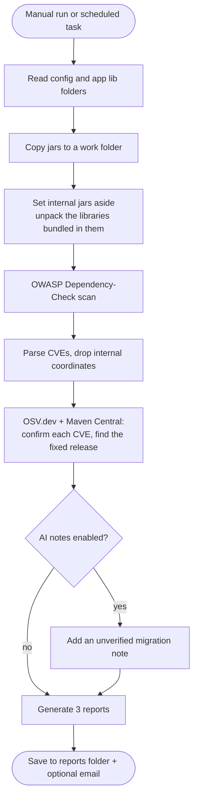

# JarXray

Automation around [OWASP Dependency-Check](https://owasp.org/www-project-dependency-check/) for the third-party jars
inside Java applications. Dependency-Check finds the known vulnerabilities; JarXray decides what it scans, checks
what it reports, and turns the result into an action list.

JarXray scans each application's `lib` folder, sets your own internal jars aside (while still scanning the
third-party libraries bundled inside them), runs Dependency-Check on the rest, checks every finding and its fixed
version against [OSV.dev](https://osv.dev) and Maven Central, and writes reports a team can act on. Run it on demand
or let it run every day on its own.

## Features

- Scans one or many Java applications in a single run; never modifies a live application folder (jars are copied first)
- **Internal code is set aside without hiding third-party code:** jars are classified by their Maven groupId and
  package names; libraries bundled in your own fat jars / WARs (`BOOT-INF/lib`, `WEB-INF/lib`) are unpacked and
  scanned, and jars with shaded third-party classes stay in the scan
- **Recommended versions from published data, not guesses:** the first stable release that OSV lists no advisory
  for, on the same build flavour; a move to a newer release line is flagged as such
- **False-positive triage:** each CVE is marked *confirmed by OSV* or *not in OSV* (Dependency-Check matches
  products by CPE name, which over-reports), together with Dependency-Check's own match confidence; reviewed false
  positives go into a standard suppression file
- Three reports per application: Dependency-Check's HTML report, an ODS action sheet and a readable dependency risk report
- Optional AI migration note per upgrade (clearly labelled as unverified; it never changes the recommendation)
- Optional email delivery and scheduled runs through Windows Task Scheduler

## How it works



## Requirements

- Windows
- Java 11 or newer (for Dependency-Check)
- Python 3.9 or newer
- A free [NVD API key](https://nvd.nist.gov/developers/request-an-api-key)
- Internet access to `api.osv.dev` and `repo1.maven.org` for the fix lookup (or `FIX_LOOKUP=no`)

## Quick start

```bat
git clone https://github.com/Faizan-Ali-code/JarXray.git
cd JarXray
scripts\setup_venv.bat
scripts\setup_dependency_check.bat
setx NVD_API_KEY "your-nvd-api-key"
run_dependency_check.bat
```

The first run creates `config\config.txt`. Fill in at least:

```ini
APP_FOLDERS=D:\QA\OrderService\lib, D:\QA\BillingApi\lib
INTERNAL_PACKAGES=com.example
```

Keys are read from environment variables (`NVD_API_KEY=${NVD_API_KEY}` in the template), so `config.txt` holds no
secrets. Then run `run_dependency_check.bat` again. The first scan downloads the NVD database (about 250 MB) and can
take an hour or more; later scans take minutes.

To scan automatically, set `SCHEDULE_ENABLED=yes` and `SCHEDULE_TIME=22:00` in `config.txt`, then run
`setup_schedule.bat` once. With `SCHEDULE_RUN_AS_SYSTEM=yes`, setup refuses if non-administrators can change the
tool's folder or its Python installation, because they could then run code as SYSTEM.

## Output

Each application gets its own folder, `reports\<application>\`:

| Report | What it is |
| --- | --- |
| `[dependency-check-report].html` | The full OWASP Dependency-Check report |
| `[dependency-check-analysis].ods` | Action list: dependency, severity, CVEs with OSV check, CPE confidence, recommended version, status |
| `[dependency-risk-report].html` | A readable summary to share with the team (an SCA summary, not a penetration test) |

## Accuracy and limits

- Detection is Dependency-Check's: JarXray cannot find what Dependency-Check misses, and cannot confirm a CVE that
  OSV has not published for the Maven package.
- "Not in OSV" means "check this", not "false positive": OSV can lag behind the NVD for new CVEs.
- A recommended version is free of *known* advisories at the time of the lookup; it still has to be tested with the
  application.

## Project structure

```
jarxray/        Python package: classification, scan, fix lookup, reports, scheduler
config/         settings templates (your config.txt is created here)
scripts/        one-time setup: Python venv, dependency-check download
apps/           optional input folder, one subfolder per application
```

Every setting is explained in [`config/config.template.txt`](config/config.template.txt).

## Authorship

- **Author:** Faizan Ali.
- **What JarXray does not do itself:**
  - Vulnerability detection is done by OWASP Dependency-Check (Apache License 2.0), which is downloaded at setup and
    not included.
  - Advisory data comes from OSV.dev, and release data from Maven Central.
