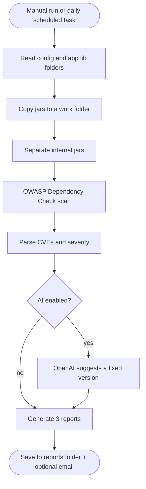

# JarXray

Automated vulnerability scanning for the third-party jars inside Java applications, built on [OWASP Dependency-Check](https://owasp.org/www-project-dependency-check/).

JarXray scans each application's `lib` folder, sets your own internal jars aside, checks the rest against the NVD vulnerability database, and turns the results into reports a team can act on. Run it on demand or let it run every day on its own.

## Features

- Scans one or many Java applications in a single run
- Sets internal jars aside by package prefix, so only third-party code is scanned
- Never modifies a live application folder: jars are copied first
- Three reports per application: raw HTML, an ODS action sheet and a readable pentest-style HTML report
- Optional AI suggestion (OpenAI) of the version that fixes each vulnerability, cached per dependency
- Optional email delivery and scheduled runs through Windows Task Scheduler

## How it works



## Requirements

- Windows
- Java 11 or newer
- Python 3.9 or newer
- A free [NVD API key](https://nvd.nist.gov/developers/request-an-api-key)

## Quick start

```bat
git clone https://github.com/Faizan-Ali-code/JarXray.git
cd JarXray
scripts\setup_venv.bat
scripts\setup_dependency_check.bat
run_dependency_check.bat
```

The first run creates `config\config.txt`. Fill in at least:

```ini
NVD_API_KEY=your-nvd-api-key
APP_FOLDERS=D:\QA\OrderService\lib, D:\QA\BillingApi\lib
INTERNAL_PACKAGES=com.example
```

Then run `run_dependency_check.bat` again. The first scan downloads the NVD database (about 250 MB) and can take an hour or more; later scans take minutes.

To scan automatically, set `SCHEDULE_ENABLED=yes` and `SCHEDULE_TIME=22:00` in `config.txt`, then run `setup_schedule.bat` once.

## Output

Each application gets its own folder, `reports\<application>\`:

| Report | What it is |
| --- | --- |
| `[dependency-check-report].html` | The full OWASP Dependency-Check report |
| `[dependency-check-analysis].ods` | Action list: dependency, severity, CVEs, recommended version, status |
| `[pentest-report].html` | A readable summary to share with the team |

## Project structure

```
depcheck_automation/   Python package: scan pipeline, reports, scheduler
config/                settings templates (your config.txt is created here)
scripts/               one-time setup: Python venv, dependency-check download
apps/                  optional input folder, one subfolder per application
```

Every setting is explained in [`config/config.template.txt`](config/config.template.txt). For setup details and troubleshooting, see [START_HERE.txt](START_HERE.txt) and [README.txt](README.txt).

> `config\config.txt` holds your API keys and SMTP password. It is listed in `.gitignore`; never commit it.

## License

[MIT](LICENSE) © 2026 Faizan Ali
